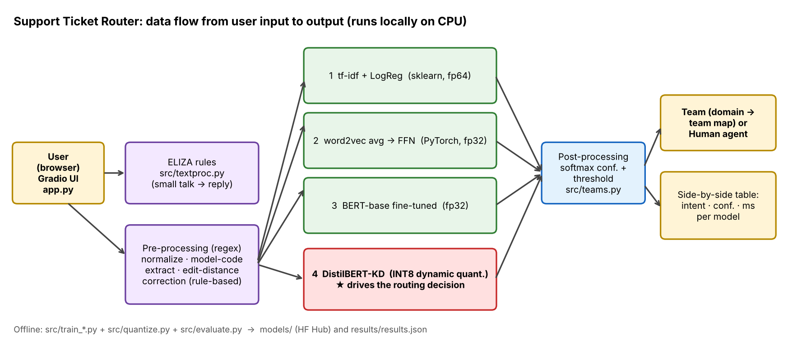

# Customer Support Ticket Router (SWE015 Homework - Use Case 2)

Free-text support message → normalize → intent + confidence → routed team.
Low-confidence / out-of-scope messages go to a **human agent**; greetings get a rule-based (ELIZA-style) reply.
The app routes with an **INT8-quantized DistilBERT** and shows three other models side by side.

| Rung | Model | Area |
|---|---|---|
| 1 | tf-idf + logistic regression | B |
| 2 | word2vec (trained on the training messages) → FFN, SGD + backprop | B + A |
| 3 | BERT-base fine-tuned with a classification head | C |
| 3b | DistilBERT distilled from BERT-base | D |
| 4 | DistilBERT-KD, dynamic INT8 quantization (**used by the app**) | D |

Extras (Area B): regex normalization and model-code extraction (`DW-6534`), minimum-edit-distance typo correction, ELIZA small-talk rules.
Data: [CLINC150](https://github.com/clinc/oos-eval) (150 intents + out-of-scope), downloaded automatically. Test set: 5,500 queries (4,500 in-scope + 1,000 out-of-scope), identical for all models. CLINC150 is general-assistant data used as a proxy; its 10 domains are mapped to support teams in `src/teams.py`.



## Setup (fresh environment)

```bash
git clone <this-repo> && cd ticket-router
python -m venv .venv && source .venv/bin/activate        # Windows: .venv\Scripts\activate
pip install -r requirements.txt
```

## Run the app (single command)

```bash
python -m src.pull_models && python app.py     # downloads weights from the Hugging Face Hub, opens http://127.0.0.1:7860
```
(`hf_repo` in `config.json` must point to your model repo. If you trained locally, `models/` already exists: just `python app.py`.)

## Reproduce training and results

BERT fine-tuning needs a GPU (free Colab T4 works, about 10-15 min per model). Everything on one command:

```bash
python run_all.py            # baseline → FFN → BERT-base → DistilBERT (KD) → INT8 → evaluate → presentation.pdf
python run_all.py --quick    # tiny smoke test (a few minutes on CPU; numbers are meaningless)
python -m src.push_models    # upload models/ to the Hub (after `huggingface-cli login`)
```
Outputs: `results/results.json` (all metrics, hardware, errors), `results/results.md` (table), `presentation.pdf`.

**Measurement protocol:** accuracy and OOS recall on the shared 5,500-query test set; size = serialized weights on disk (MB); latency = mean ± std of 100 single-query runs after 10 warm-ups, CPU only, torch threads = 1 (hardware recorded in `results.json`).

## Layout
`app.py` Gradio UI · `src/textproc.py` regex / edit distance / ELIZA · `src/train_*.py` models · `src/quantize.py` INT8 · `src/evaluate.py` benchmark · `make_report.py` slides · `docs/` diagram and video script.

## AI usage
Code was written with Claude (Anthropic) and reviewed, run and evaluated by the author. All reported numbers come from `results/results.json`.
